  

# Hey, I'm fbirds5230 👋

I contribute to open-source tools, with a focus on bug fixes, edge cases, and regression tests.

Recently, that has meant keeping process output intact, making sure empty CSV records survive an export, and getting configuration files to behave as expected.

**Working with:** `TypeScript` · `Go` · `Python`

## A few things I've worked on

| Project | Contribution |
| --- | --- |
| **[go-pretty](https://github.com/jedib0t/go-pretty/pull/469)** · Go | Preserving empty records in single-column CSV output. **Merged upstream.** |
| **[tinyexec](https://github.com/tinylibs/tinyexec/pull/195)** · TypeScript | Keeping captured process output available across repeated awaits and concurrent handlers. |
| **[ConfigUpdater](https://github.com/pyscaffold/configupdater/pull/198)** · Python | Respecting custom option-name handling when validating and saving configuration files. |

These links go to my pull requests in the original projects. Each change includes regression tests.

## How I approach a fix

Reproduce the problem, understand what's causing it, and keep the patch focused. Then add a test that catches it next time.

---

[Browse my repositories](https://github.com/fbirds5230?tab=repositories) · [See my pull requests](https://github.com/pulls?q=is%3Apr+author%3Afbirds5230)
